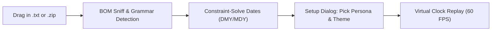

# rewhatsapp

<div align="center">

[](https://github.com/your-username/rewhatsapp/actions/workflows/ci.yml)
[](LICENSE)
[](package.json)
[](#lighthouse-audit)

**A private, zero-runtime-dependency time machine for your WhatsApp conversations.**

Relive your memories live as if they were happening right now — every late reply, every "haha stop 🙈", every 2 a.m. "you up?".

[Try the Live Demo](https://your-username.github.io/rewhatsapp/) · [Try a Sample Memory](#try-a-sample-memory) · [Privacy Verification](#privacy-guarantees)

</div>

---

## What is rewhatsapp?

When you export a WhatsApp chat, you get an unreadable, flat `.txt` or `.zip` file containing thousands of disconnected timestamps.

**rewhatsapp** transforms that raw archive back into living, breathing theater. It parses your export completely inside your browser, asks which participant is you, and replays the conversation in a pixel-faithful recreation of WhatsApp Web / mobile in real-time — with typing simulations, procedural Web Audio sound effects, dead-air compression, and emotional conversation insights.

---

## ✨ Features

- **Pixel-Faithful Replay**:
  - Light and Dark WhatsApp themes.
  - Authentic speech bubbles with directional tails, read-receipt ticks (single grey → double grey → blue upon response), timestamps, and centered date chips.
  - Original SVG doodle wallpaper evocative of classic chat backgrounds.
  - Responsive layout adapting seamlessly from 360px mobile to 4K ultrawide desktop displays.
- **⚡ Smart Time (Dead-Air Compression)**:
  - Three replay modes: _Smart_ (logarithmic compression of conversational dead-air), _Real-time_ (1:1 calendar duration), and _Fixed cadence_ (steady tempo).
  - Time-skip chips (`🌙 3 days later`) appear with a subtle clock sweep animation during long pauses.
- **Typing Simulation**:
  - The contact status dynamically switches between `"online"` and `"typing…"`.
  - For your own messages, the composer bar simulates character-by-character typing before "sending" with a soft pop.
- **Zero-Asset Sound Effects**:
  - Send, receive, and tick sounds procedurally synthesized via the Web Audio API. Zero external audio files downloaded.
  - Deterministic voice note waveforms seeded from the message hash.
- **📊 Deep Conversation Insights**:
  - Interactive 7×24 hour×weekday activity heatmap.
  - Median response times per participant.
  - Longest conversation silence & longest daily talking streak.
  - Emoji leaderboard and total word/message metrics.
  - Emotional epilogue memory card when the chat reaches its conclusion.
- **Emotion Timeline Scrubber**:
  - Dual progress scrubber and sparkline of message density × mood valence.
- **⌨️ Power-User Layer & Command Palette**:
  - Spotlight search command palette (`Ctrl/⌘+K`).
  - Full keyboard shortcuts: `Space` (play/pause), `← / →` (prev/next message), `[ / ]` (speed down/up), `F` (fullscreen), `I` (insights), `M` (mute), `Esc` (exit).
- **🔒 100% Client-Side Privacy**:
  - Strict Content Security Policy (`connect-src 'none'`).
  - Zero telemetry, zero analytics, zero CDNs, zero runtime dependencies.

---

## 30-Second How It Works



1. **Drop your file**: Drag in an exported `.txt` or iOS `.zip` file (or click **Try a sample memory**).
2. **Choose who you are**: Pick your persona chip so your messages appear on the right with outgoing ticks.
3. **Select your world**: Choose between WhatsApp Light or Dark, pick your starting speed and Smart Time mode.
4. **Travel back**: Watch the time dial whirl backward and enjoy your conversation unfolding in real-time.

---

## Privacy Guarantees

Your memories belong to you and no one else.

| Security Property    | Implementation in rewhatsapp                                      |
| :------------------- | :---------------------------------------------------------------- |
| **Network Requests** | `connect-src 'none'` CSP blocks all outgoing network calls.       |
| **Server Storage**   | 0 bytes uploaded. Everything runs in local browser memory.        |
| **Fonts & CDNs**     | Zero external fonts or CDNs. Standard system typography.          |
| **Audio Assets**     | Zero audio files downloaded. Web Audio API synthesizers.          |
| **XSS Protection**   | Zero `innerHTML` with data. Safe DOM `textContent` APIs.          |
| **Data Persistence** | Only UI preferences (theme, mute, speed) saved to `localStorage`. |

### How to verify in 30 seconds:

1. Open DevTools (`F12` or `Cmd + Option + I`).
2. Switch to the **Network** tab and check **Preserve log**.
3. Drag in your chat export.
4. **Notice that zero network requests are made.** You can even disconnect your internet completely!

Read our full [Privacy Architecture](docs/PRIVACY.md) and [Security Threat Model](SECURITY.md).

---

## Keyboard Shortcuts

| Shortcut                                                     | Action                                                       |
| :----------------------------------------------------------- | :----------------------------------------------------------- |
| <kbd>Ctrl</kbd> + <kbd>K</kbd> / <kbd>⌘</kbd> + <kbd>K</kbd> | Open Command Palette                                         |
| <kbd>Space</kbd>                                             | Play / Pause Replay                                          |
| <kbd>→</kbd>                                                 | Jump to Next Message                                         |
| <kbd>←</kbd>                                                 | Jump to Previous Message                                     |
| <kbd>]</kbd> / <kbd>[</kbd>                                  | Increase / Decrease Speed (0.5×, 1×, 2×, 5×, 10×, 20×)       |
| <kbd>F</kbd>                                                 | Toggle Fullscreen (with immersive fallback on iPhone Safari) |
| <kbd>I</kbd>                                                 | Toggle Conversation Insights & Heatmap                       |
| <kbd>M</kbd>                                                 | Toggle Audio Mute                                            |
| <kbd>Esc</kbd>                                               | Close Modal / Exit Replay                                    |

---

## Architecture

Built following clean architectural principles: a **pure core with zero DOM access**, a thin presentation layer, and a minimal composition root.

```
rewhatsapp/
├── index.html                  # Semantic shell, strict CSP, no inline scripts
├── manifest.webmanifest, sw.js # Offline PWA support
├── server.js                   # Zero-dependency local development server
├── src/
│   ├── main.js                 # Composition root
│   ├── core/
│   │   ├── parser/             # Grammar detection, dates, BOM, participants
│   │   ├── zip.js              # Native DecompressionStream('deflate-raw')
│   │   ├── timeline.js         # Typed Float64Array / Uint32Array structures
│   │   ├── player.js           # requestAnimationFrame virtual clock
│   │   └── analytics/          # 7x24 heatmap, response times, sentiment
│   ├── ui/
│   │   ├── home/               # Time machine hero, dial, portal dropzone
│   │   ├── setup/              # 3-step persona & theme selection
│   │   ├── replay/             # Chat view, bubbles, header, composer, scrubber
│   │   ├── insights/           # Heatmap, response times, epilogue card
│   │   └── palette/            # Command palette (Ctrl+K)
│   ├── audio/synth.js          # Web Audio API sound synthesizer
│   ├── util/                   # dom.js, linkify.js, format.js, hash.js, a11y.js
│   └── styles/                 # tokens.css, home.css, setup.css, replay.css
├── test/                       # 13 synthetic fixtures & node:test suite
└── docs/                       # ARCHITECTURE.md, PARSING.md, PRIVACY.md
```

Read our in-depth guides:

- [System Architecture](docs/ARCHITECTURE.md)
- [Parsing Architecture & Heuristics](docs/PARSING.md)
- [Privacy & Security Auditing](docs/PRIVACY.md)

---

## Supported Formats & Locales

- **Android**: 24-hour and 12-hour AM/PM formats (`DD/MM/YYYY, HH:MM - Sender: Message`).
- **iOS**: Bracketed with or without seconds (`[DD/MM/YY, H:MM:SS AM] Sender: Message`).
- **German / European dot-separated**: `DD.MM.YY, HH:MM - Sender: Message`.
- **Spanish AM/PM**: `DD/MM/YY, H:MM a. m. - Sender: Message`.
- **iOS .zip archives**: Native decompression of `_chat.txt`.
- **BOMs**: UTF-8, UTF-16LE, UTF-16BE.

Want to add another language? Check out the [Contributing Guide](CONTRIBUTING.md).

---

## Browser Support

| Browser                         | Version | Support                                              |
| :------------------------------ | :------ | :--------------------------------------------------- |
| **Google Chrome / Chromium**    | 80+     | Full (Real Fullscreen, Web Audio, PWA)               |
| **Apple Safari (macOS)**        | 14+     | Full                                                 |
| **Apple Safari (iOS / iPadOS)** | 14.5+   | Immersive Fullscreen Fallback (`100dvh`, Safe Areas) |
| **Mozilla Firefox**             | 78+     | Full                                                 |
| **Microsoft Edge**              | 80+     | Full                                                 |

---

## Non-Affiliation Disclaimer

**rewhatsapp** is an independent open-source project and is **not affiliated with, associated with, authorized by, endorsed by, or in any way officially connected with WhatsApp LLC or Meta Platforms, Inc.** The official WhatsApp website can be found at https://whatsapp.com.

---

## License

MIT © [rewhatsapp contributors](LICENSE)
