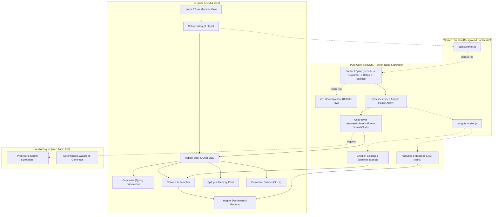

# Architecture of rewhatsapp

`rewhatsapp` is architected as an offline-first, client-side progressive web application built with vanilla web technologies and zero runtime dependencies.

---

## 1. High-Level System Architecture



---

## 2. Layer Separation & Responsibilities

The codebase enforces strict unidirectional dependency flow across three tiers:

```
src/
├── audio/            # Web Audio API sound generator (Zero sound assets)
├── core/             # Pure computational engine (Zero DOM, runs in Node.js & browser)
│   ├── analytics/    # 7x24 heatmap calculation, response times, sentiment
│   ├── parser/       # Multi-locale WhatsApp grammar parser & date solver
│   ├── player.js     # rAF virtual playback clock with speed & pausing
│   ├── store.js      # Decoupled reactive observable state store
│   ├── timeline.js   # TypedArray binary search timeline (Float64Array)
│   └── zip.js        # Native Web Streams deflate-raw ZIP decompressor
├── data/             # Sample conversation dataset for instantaneous demo
├── styles/           # Modular CSS design system (tokens, home, replay, motion)
├── ui/               # Safe DOM renderer (createElement, attributes, a11y)
├── util/             # Helpers (Bidi sanitize, emoji segmentation, DOM, hash)
└── workers/          # Web Workers for asynchronous parsing and analytics
```

### 2.1 `src/core/` (Pure Logic Layer)
- **Zero DOM dependency**: Contains no references to `window`, `document`, or DOM elements. All modules are table-tested under Node.js (`node:test`).
- **Memory efficiency**: Timestamps and cumulative playback offsets are stored in typed `Float64Array` buffers. Participant indices are stored in `Uint32Array` buffers. A 500,000-message export consumes minimal heap memory without main-thread freeze.
- **Drift-Free Virtual Clock**: Time advances via `virtualTime += clampedDt * speed` inside `requestAnimationFrame`. Automatically clamps `dt` and pauses during `visibilitychange` so tab switches never trigger desync.

### 2.2 `src/ui/` (Presentation Layer)
- **Safe DOM APIs**: All elements are constructed via `document.createElement`, `element.setAttribute`, and `element.textContent` with zero HTML injection vulnerabilities.
- **Windowed Message Rendering**: Replay seeking calculates a window of ~60 messages around the seek target, recycling DOM nodes to sustain consistent 60fps scrolling on both mobile and low-powered hardware.
- **CSS Tokens & Design System**: Separate visual worlds for the ethereal twilight Home screen (`home.css`) and faithful WhatsApp Web / mobile recreation (`replay.css`), controlled via CSS custom properties in `tokens.css`.

### 2.3 `src/audio/` (Zero-Asset Sound Synthesis)
- **Web Audio API**: Procedurally synthesizes sending pop tones, incoming message chime harmonies, and tick sounds. Zero audio files (`.mp3`/`.wav`) are shipped.
- **Stable Voice Waveforms**: Generates deterministic amplitude peaks seeded by hashing the message text and sender name (`djb2`), guaranteeing identical visual waveforms across replays.

### 2.4 `src/workers/` (Background Threads)
- **`parse.worker.js`**: Streams and parses large `.txt` and `.zip` archives off the main thread, dispatching early metadata so the setup dialog displays instantly.
- **`insights.worker.js`**: Calculates 7x24 weekday-hour heatmaps, response time medians, and emotion sparklines asynchronously.

---

## 3. Parser Pipeline & Heuristics (`src/core/parser/`)

Parsing WhatsApp exports without a formal grammar specification is historically fragile. `rewhatsapp` utilizes an 8-stage heuristic pipeline:

```
Raw Input (Text / ArrayBuffer / ZIP)
  │
  ├─ 1. Sniff BOM & Decode (UTF-8, UTF-16LE, UTF-16BE)
  ├─ 2. Normalize Unicode (Bidi controls, Narrow NBSP, Arabic/Devanagari digits)
  ├─ 3. Detect Grammar by Scoring (First 200 non-empty lines)
  ├─ 4. Compile Strict Regex & Tokenize (Headers vs Continuations)
  ├─ 5. Constraint-Solve Date Order (DMY vs MDY vs YMD)
  ├─ 6. Two-Pass Sender Discovery (System Events vs Participants)
  ├─ 7. Classify Records (Emoji counts, Media, Voice, Deleted, Calls)
  └─ 8. Deterministic Sub-Minute Spreading (Monotonic timestamps)
```

1. **BOM Sniffing & Character Decoding (`decode.js`)**:
   - Detects `EF BB BF` (UTF-8), `FF FE` (UTF-16 Little Endian), and `FE FF` (UTF-16 Big Endian). Decodes via native `TextDecoder`.
2. **Unicode Normalization (`normalize.js`)**:
   - Strips iOS Bidirectional controls (`\u200E`, `\u200F`, `\u202A-\u202E`).
   - Normalizes narrow non-breaking spaces (`\u202F`, `\u00A0`) in timestamps to standard ASCII spaces.
   - Maps Arabic-Indic (`٠-٩`) and Devanagari (`०-९`) numerals to standard digits (`0-9`).
3. **Candidate Grammar Scoring (`grammar.js`)**:
   - Tests the first 200 non-empty lines against candidate grammar definitions:
     - Android 24h (`DD/MM/YYYY, HH:MM - Sender: Message`)
     - Android US 12h (`MM/DD/YY, H:MM AM - Sender: Message`)
     - iOS Bracketed with Seconds (`[DD/MM/YYYY, HH:MM:SS] Sender: Message`)
     - iOS Bracketed 12h (`[M/D/YY, H:MM:SS AM] Sender: Message`)
     - German Dot-Separated (`DD.MM.YY, HH:MM - Sender: Message`)
     - Spanish Hyphenated (`DD/MM/YY, H:MM a. m. - Sender: Message`)
   - Requires valid header delimiters (`- ` or `] `) to prevent wrapped multiline text from falsely triggering as a header.
4. **Date Order Constraint Solver (`dates.js`)**:
   - Solves ambiguous dates (`04/05/2023` — May 4 vs April 5) across the entire conversation:
     - Hard constraints: First field $> 12 \implies \text{DMY}$; second field $> 12 \implies \text{MDY}$; 4-digit field $\implies \text{YMD}$.
     - Monotonicity evaluation: Picks the hypothesis that minimizes chronological time inversions.
     - Interactive override: Surfaces an instant `DD/MM ↔ MM/DD` toggle in the setup modal.
5. **Floating UTC Timestamps**:
   - Parses dates into `Date.UTC(...)` and accesses values via `getUTC*`. Eliminates phantom Daylight Saving Time (DST) jumps and duplicate hours.
6. **Two-Pass Sender Discovery (`participants.js`)**:
   - Distinguishes system events with colons from real senders using localized system event dictionaries (`locales.js`).
7. **Deterministic Sub-Minute Spreading (`spread.js`)**:
   - Android exports lack second timestamps (`HH:MM`). Multiple messages in the same minute are distributed smoothly using index-seeded micro-offsets, guaranteeing strict monotonic DOM rendering.

---

## 4. In-Browser Zero-Dependency ZIP Reader (`src/core/zip.js`)

Rather than relying on large third-party archives like JSZip, `rewhatsapp` implements a native, zero-dependency ZIP reader built on the browser's native Web Streams API (`DecompressionStream('deflate-raw')`):
- Parses local file headers to extract filenames and compression flags.
- Inflates compressed deflate-raw byte streams directly into memory buffers.
- Extracts `_chat.txt` for parsing and converts embedded media into transient `URL.createObjectURL(blob)` handles.

---

## 5. Virtual Playback Clock & Timeline (`src/core/player.js` & `timeline.js`)

- **Typed Array Storage**: Timestamps and cumulative playback offsets are stored in flat `Float64Array` buffers; sender IDs in `Uint32Array`.
- **Binary Search Seeking**: `findMessageIndexAtTime(time)` achieves $O(\log N)$ seeking time on the scrubber.
- **Drift-Free Virtual Clock**: Time advances inside `requestAnimationFrame`:
  $$\text{virtualTime} += \text{clampedDt} \times \text{speed}$$
- **Tab Invisibility Safeguard**: Automatically halts clock accumulation when the user switches tabs, preventing giant message floods upon return.
- **Typing Simulation Pipeline**: Outgoing messages calculate dynamic typing delays:
  $$\text{delay} = \text{baseDelay} + (30\text{ ms} \times \text{charCount})$$

---

## 6. Procedural Sound Synthesis (`src/audio/synth.js`)

Zero audio assets (`.mp3` or `.wav`) are shipped with the application:
- **Outgoing Pop**: A rapid sine frequency glide ($440\text{ Hz} \to 880\text{ Hz}$) with exponential gain decay.
- **Incoming Chime**: A dual-oscillator harmonic chord ($587.33\text{ Hz}$ D5 + $880\text{ Hz}$ A5) with gentle attack and sustain.
- **Seeded Voice Waveforms**: Generates deterministic voice note bar heights by hashing message text and sender name (`djb2` hash), ensuring identical visual waveforms every replay.

---

## 7. Dual Visual Design System & Sticky Choreography

### 7.1 Visual Atmosphere
- **The Time Machine Portal (`home.css` & `styles.css`)**:
  - Ethereal journal vault theme (`#f9f6f0` background).
  - Plus Jakarta Sans paired with Lora serif.
  - Dual living metallic shader gradients (gold CTA shimmer and silver/platinum borders).
  - Liquid glass pill navbar with specular highlight reflection.
- **The Replay Theater (`replay.css`)**:
  - Pixel-perfect recreation of WhatsApp Web / mobile.
  - Authentic chat bubbles with SVG directional tails, system date chips, message ticks (single grey, double grey, double blue).
  - Procedural SVG wallpaper background with customizable tint.

### 7.2 Fluid Sticky Card-Deck Choreography
- Feature cards stack center-stage beneath a stationary, pinned section title (`.features-header`).
- As subsequent cards scroll into view, previous cards scale down (`scale(0.95)`) and gently dim (`opacity: 0.9`).
- **Lockstep Exit Choreography**: When the final card (Card 4) finishes stacking and the user scrolls toward the next section, `.features-header` translates upward in direct synchrony with Card 4 via `translateY(-${pullUp}px)`. The 12px–16px gap is permanently locked, preventing cards from sliding behind the header, eliminating empty space, and handing off seamlessly to the Privacy section.

---

## 8. Zero-Backend Architecture & Local Server

### 8.1 No-Backend Security Paradigm
`rewhatsapp` contains zero backend code for processing user communications. When a user loads the app, static files are cached. All chat parsing, media extraction, timeline calculation, and rendering occurs purely inside the client device's browser memory (RAM).

### 8.2 Native Node.js Static Server (`server.js`)
For local deployment and testing, a lightweight zero-dependency HTTP server runs on native Node.js (`node:http`, `node:fs`, `node:path`):
- **Path Traversal Sanitization**: Uses `path.normalize(reqPath).replace(/^(\.\.[/\\])+/, '')`.
- **Strict Anti-Caching Headers**:
  ```http
  Cache-Control: no-store, no-cache, must-revalidate, proxy-revalidate, max-age=0
  Pragma: no-cache
  Expires: 0
  ```
- **MIME Resolution**: Supports modern web formats (`.html`, `.css`, `.js`, `.webmanifest`, `.svg`, `.json`).
