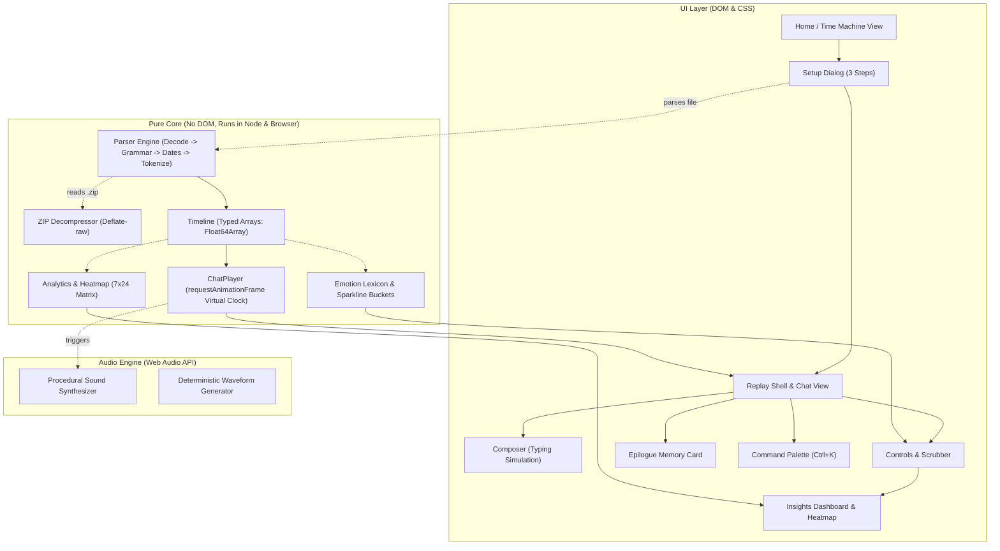

# Architecture of rewhatsapp

`rewhatsapp` is architected as an offline-first, client-side progressive web application built with vanilla web technologies and zero runtime dependencies.

---

## 1. High-Level System Architecture

---

## 2. Layer Separation & Responsibilities

### `src/core/` (Pure Logic Layer)

- **Zero DOM dependency**: Contains no references to `window`, `document`, or DOM elements. All modules are table-tested under Node.js (`node:test`).
- **Memory efficiency**: Timestamps and cumulative playback offsets are stored in typed `Float64Array` buffers. Participant indices are stored in `Uint32Array` buffers. A 500,000-message export consumes negligible memory without main-thread freeze.
- **Drift-Free Virtual Clock**: Time advances via `virtualTime += clampedDt * speed` inside `requestAnimationFrame`. Automatically clamps `dt` and pauses during `visibilitychange` so tab switches never trigger desync.

### `src/ui/` (Presentation Layer)

- **Safe DOM APIs**: All elements are constructed via `document.createElement`, `element.setAttribute`, and `element.textContent`.
- **Windowed Message Rendering**: Replay seeking calculates a window of ~60 messages around the seek target, recycling DOM nodes to sustain consistent 60fps scrolling on both mobile and low-powered hardware.
- **CSS Tokens & Design System**: Separate worlds for the ethereal twilight Home screen (`home.css`) and faithful WhatsApp Web / mobile recreation (`replay.css`), controlled via CSS custom properties in `tokens.css`.

### `src/audio/` (Zero-Asset Sound Synthesis)

- **Web Audio API**: Procedurally synthesizes sending pop tones, incoming message chime harmonies, and tick sounds.
- **Stable Voice Waveforms**: Generates deterministic amplitude peaks seeded by hashing the message text and sender name, guaranteeing identical visual waveforms across replays.

### `src/workers/` (Background Threads)

- **`parse.worker.js`**: Streams and parses huge `.txt` and `.zip` archives off the main thread, dispatching early metadata so the setup dialog displays instantly.
- **`insights.worker.js`**: Calculates 7x24 weekday-hour heatmaps, response time medians, and emotion sparklines asynchronously.

---

## 3. State Management

A lightweight Map-based observable store powers decoupled event dispatching without external state libraries. Components subscribe via typed callbacks (`player.on('message', ...)`).
